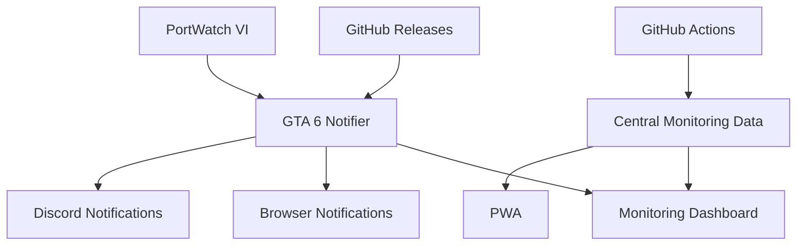

# GTA 6 Notifier

### Stay updated. Never miss a GTA 6 community milestone.

**Created by [Nicknrss](https://github.com/Nicknrss)**

---

# 🇺🇸 English

## 🚀 About the project

**GTA 6 Notifier** is a monitoring and notification project designed to keep the community informed about important GTA 6-related developments.

It monitors new GitHub Releases from selected repositories and tracks PortWatch VI leaderboard and progress updates.

The project includes a browser extension, a monitoring dashboard, and a companion Progressive Web App (PWA).

## ✨ Features

| Feature | Description |
|---|---|
| 🎮 GitHub Releases | Detects new Releases from configured repositories. |
| 🏆 PortWatch VI | Tracks leaderboard changes, rankings and scores. |
| 📊 Dashboard | Displays monitoring information, history and statistics. |
| 🔔 Browser Notifications | Sends local notifications through the browser. |
| 💬 Discord | Supports optional Discord webhook notifications. |
| 📱 PWA | Includes an installable companion web application. |
| 🌍 Multilingual | Supports multiple interface languages. |

## 🖥️ How it works

## 🌐 Supported browsers

- Google Chrome
- Brave
- Chromium-based browsers
- Mozilla Firefox

The project includes separate extension builds for Chromium and Firefox.

## 📥 Installation

### Chrome / Brave

1. Download or clone this repository.
2. Extract the files.
3. Open `chrome://extensions` or `brave://extensions`.
4. Enable **Developer mode**.
5. Select **Load unpacked**.
6. Choose the `extension/chromium` folder.

### Firefox

1. Open `about:debugging`.
2. Select **This Firefox**.
3. Click **Load Temporary Add-on**.
4. Select the Firefox extension manifest from `extension/firefox`.

Temporary Firefox installation may need to be repeated after restarting the browser. Permanent distribution requires the appropriate Firefox signing process.

## 🔔 Notifications

The extension supports browser notifications and optional Discord alerts.

Notification categories include:

- New GitHub Releases.
- PortWatch VI leaderboard changes.
- PortWatch VI progress updates.

The browser must remain open for the extension's scheduled monitoring and local notifications.

## 📱 Progressive Web App

The repository also includes a companion PWA.

It provides an installable web interface and can read the central monitoring data published in the repository.

Background Web Push requires the optional external push service and VAPID configuration.

## ⚙️ Central monitoring

The repository includes a GitHub Actions workflow and a Python monitoring script.

These components collect public GitHub Release feed information and PortWatch VI tracker data, then update JSON files in the `data/` directory.

The first monitoring run establishes a baseline. Subsequent changes can be recorded in the central history.

## 🔒 Privacy

- Browser monitoring data is stored locally by the extension.
- Discord notifications require a webhook configured by the user.
- Public central monitoring data is stored in the repository.
- Never publish private tokens, webhook URLs or secret keys.

## ❤️ Credits

Developed and maintained by **[Nicknrss](https://github.com/Nicknrss)**.

If you find this project useful, consider starring the repository!

**GTA 6 Notifier 1.0.0 · Made by Nicknrss**

[GitHub Repository](https://github.com/Nicknrss/GTA-6-Notifier) · [Developer Profile](https://github.com/Nicknrss)

---

# 🇧🇷 Português

## 🚀 Sobre o projeto

O **GTA 6 Notifier** é um projeto de monitoramento e notificações criado para manter a comunidade informada sobre novidades importantes relacionadas ao GTA 6.

Ele monitora novos Releases de repositórios selecionados no GitHub e acompanha atualizações de pontuação e ranking do PortWatch VI.

O projeto conta com uma extensão para navegadores, um painel de monitoramento e um aplicativo complementar em formato PWA.

## ✨ Funcionalidades

| Recurso | Descrição |
|---|---|
| 🎮 GitHub Releases | Detecta novos Releases dos repositórios configurados. |
| 🏆 PortWatch VI | Acompanha mudanças no ranking, posições e pontuações. |
| 📊 Painel | Apresenta informações, histórico e estatísticas do monitoramento. |
| 🔔 Notificações | Envia notificações locais pelo navegador. |
| 💬 Discord | Permite configurar notificações por webhook do Discord. |
| 📱 PWA | Inclui um aplicativo web complementar instalável. |
| 🌍 Multilíngue | Oferece suporte a vários idiomas na interface. |

## 🖥️ Como funciona

O GTA 6 Notifier consulta as fontes configuradas, identifica atualizações e apresenta as informações no painel.

As notificações podem ser enviadas pelo navegador e, opcionalmente, pelo Discord.

## 🌐 Navegadores compatíveis

- Google Chrome
- Brave
- Navegadores baseados em Chromium
- Mozilla Firefox

O projeto possui versões separadas da extensão para Chromium e Firefox.

## 📥 Instalação

### Chrome / Brave

1. Baixe ou clone este repositório.
2. Extraia os arquivos.
3. Acesse `chrome://extensions` ou `brave://extensions`.
4. Ative o **Modo do desenvolvedor**.
5. Clique em **Carregar sem compactação**.
6. Selecione a pasta `extension/chromium`.

### Firefox

1. Acesse `about:debugging`.
2. Selecione **Este Firefox**.
3. Clique em **Carregar extensão temporária**.
4. Selecione o manifesto da extensão na pasta `extension/firefox`.

A instalação temporária no Firefox pode precisar ser repetida após reiniciar o navegador. A distribuição permanente exige o processo de assinatura apropriado do Firefox.

## 🔔 Notificações

A extensão oferece notificações do navegador e alertas opcionais pelo Discord.

As categorias incluem:

- Novos Releases do GitHub.
- Alterações no ranking do PortWatch VI.
- Atualizações de progresso do PortWatch VI.

O navegador precisa permanecer aberto para que o monitoramento agendado e as notificações locais da extensão funcionem.

## 📱 Aplicativo PWA

O repositório também inclui uma PWA complementar.

Ela oferece uma interface web instalável e pode consultar os dados centrais de monitoramento publicados no repositório.

As notificações Web Push em segundo plano exigem um serviço externo opcional e a configuração de chaves VAPID.

## ⚙️ Monitoramento central

O projeto inclui um workflow do GitHub Actions e um script de monitoramento em Python.

Esses componentes coletam informações dos feeds públicos de Releases do GitHub e dos dados do tracker do PortWatch VI. Em seguida, atualizam os arquivos JSON da pasta `data/`.

A primeira execução estabelece uma linha de base. As alterações seguintes podem ser registradas no histórico central.

## 🔒 Privacidade

- Os dados locais de monitoramento da extensão ficam armazenados no navegador.
- As notificações pelo Discord exigem um webhook configurado pelo usuário.
- Os dados centrais publicados no repositório são públicos.
- Nunca publique tokens privados, URLs de webhook ou chaves secretas.

## ❤️ Créditos

Desenvolvido e mantido por **[Nicknrss](https://github.com/Nicknrss)**.

Se você gostou do projeto, considere deixar uma estrela no repositório!

**GTA 6 Notifier 1.0.0 · Feito por Nicknrss**

[Repositório no GitHub](https://github.com/Nicknrss/GTA-6-Notifier) · [Perfil do desenvolvedor](https://github.com/Nicknrss)

**Observação:** usei o logo que já existe em `assets/GN-logo.png` e mantive as descrições técnicas compatíveis com a estrutura do projeto. O diagrama é renderizado pelo próprio GitHub via Mermaid.
